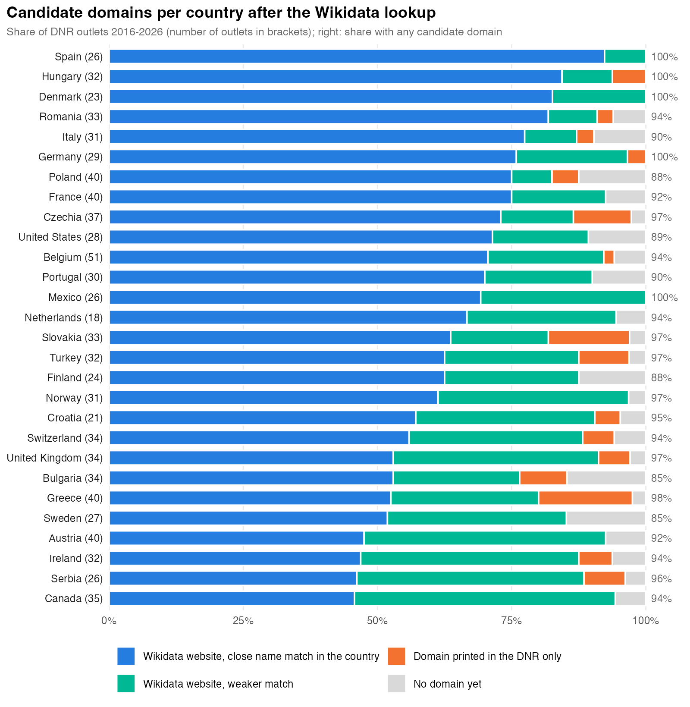

# Outlet and domain extraction: report

*Running record of what was done and what came out, one section per step. The plan for the remaining steps is in `outlet_domains_plan.md`. Last updated 2026-11-27.*

## 1. Outlets from the Reuters Digital News Report

- **Source**: the "top brands" charts (weekly reach, offline and online) on the country pages of the DNR 2012–2026 (`data_collection/DNRs/`).
- **Method**: automatic transcription from the text layer of the PDFs (`scripts/parse_dnr.py`, kept for documentation), then a row-by-row check against the reports by the RA (PR #3). The check removed one row and merged three outlet ids; the yearly tables `outlets_<year>.csv` are the authoritative version.
- **Result**: 10,698 rows and 1,026 outlet ids for 2012–2026.
- **Scope used from here on, 2016–2026**: 10,083 rows, 995 outlet ids, 28 countries (22 in 2016, 28 from 2025) in 31 markets. 108 ids are generic categories ("local newspaper", "commercial TV news"), which leaves **887 outlets**.
- **Domains at this stage**: 254 outlets have a domain because the DNR printed the brand as a domain ("Watson.ch") or the RA researched it for 2016.

## 2. Candidate domains from Wikidata

- **Method** (`scripts/wikidata_prefill.py`): each outlet's printed brand names are searched in Wikidata among items of the outlet's country; items that are not media (by their class) are dropped; the best name match is kept with its official website. Outlets without a good match in the country (mostly foreign brands such as CNN or BBC) are searched worldwide. Output: `wikidata_candidates.csv`, one row per outlet.
- **Result**: an item for 841 of 887 outlets, a website for 796 (90%). Together with the printed domains, 835 outlets have at least one candidate domain and 52 have none.
- **Match quality**: 576 outlets have a website, a near-exact name match and the right country. 173 were matched worldwide and 66 have a weak name match; these are flagged in the file.

- **Check against the printed domains**: for 215 outlets both a printed and a Wikidata domain exist. They agree for 170 (79%). The 45 disagreements are, in roughly equal parts, a wrong Wikidata item (Channel 5 → `pbskids.org`), a domain that changed over time (`n24.de` → `welt.de`), and the broadcaster's corporate site instead of its news site (`tn.cz` vs `nova.cz`). Wrong items are about 7% of the 215.
- **Earlier domains** (`scripts/wikidata_history.py` → `wikidata_domain_history.csv`): Wikidata dates almost no website statements (34 carry a start or end date), but older websites survive as additional values on the item and in its edit history, where every change to the website records the URL and the edit date. 228 outlets have at least one domain besides the selected one (427 domains: 285 still on the item, 142 only in the edit history). For 17 of the 45 disagreements above, the printed domain reappears there.
- **Limits**: edit dates say when an editor recorded a URL, not when the outlet moved. The additional domains also include international editions (HuffPost has 16) and unrelated sites, so they are candidates for the next step, not results. Domains never entered in Wikidata (`b.dk` for Berlingske) are not recovered.
